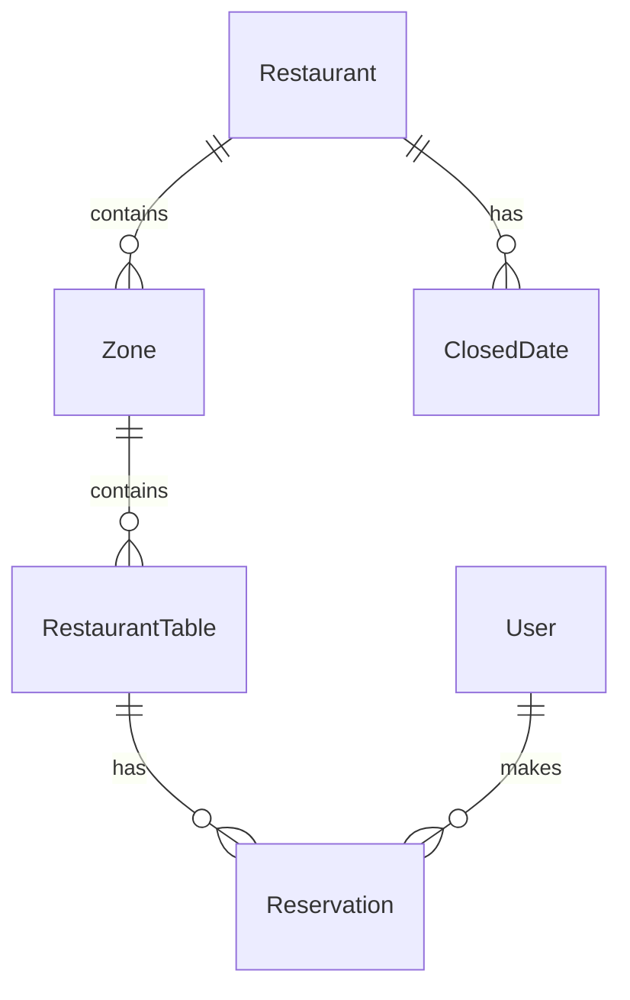

# BookingSystem

A restaurant table reservation backend built with C# and ASP.NET Core. The project is being developed incrementally, with restaurant and table management services, SQL Server persistence, and Development seed data already implemented.

**Status: work in progress.** Restaurant and table operations are implemented at the application service level. Authentication, reservation business logic, and API controllers are still planned.

## Tech stack

| Technology | Current use |
| --- | --- |
| .NET 9 / C# | Target framework and language |
| ASP.NET Core Web API | API host and controller infrastructure |
| Entity Framework Core 9 | Database context and entity configurations |
| SQL Server | Database provider configured through `AddInfrastructure` |
| OpenAPI | JSON document exposed in the Development environment |
| Swagger UI | Interactive documentation at `/swagger` in Development |
| BCrypt.Net-Next | Password hashing for Development seed accounts |
| FluentValidation | Validator discovery registered; request validators still planned |
| Mapster | Package included for future DTO mapping |
| JWT Bearer authentication | Package included; authentication setup planned |
| Serilog | Package included; logging integration planned |

## Project structure

```text
BookingSystem/
├── BookingSystem.API/
│   ├── Controllers/
│   ├── Properties/
│   └── Program.cs
├── BookingSystem.Application/
│   ├── Auth/
│   ├── Common/Models/
│   ├── Reservations/
│   ├── Restaurants/
│   ├── Tables/
│   └── DependencyInjection.cs
├── BookingSystem.Domain/
│   ├── Common/
│   ├── Entities/
│   └── Enums/
├── BookingSystem.Infrastructure/
│   ├── Configurations/
│   ├── Migrations/
│   ├── DependencyInjection.cs
│   ├── DbSeeder.cs
│   └── AppDbContext.cs
└── BookingSystem.sln
```

| Project | Contents |
| --- | --- |
| `BookingSystem.Domain` | Entities, shared entity types, and enums |
| `BookingSystem.Application` | Restaurant and table services, authentication and reservation contracts, DTOs, and pagination model |
| `BookingSystem.Infrastructure` | EF Core context, entity configurations, migrations, and Development seeder |
| `BookingSystem.API` | Application entry point, dependency registration, middleware, OpenAPI, and Swagger UI |

## What is already in place

- Domain entities and their relationships.
- Customer and Admin roles; Indoor, Terrace, and VIP zones.
- Reservation statuses: Pending, Confirmed, Seated, Completed, Cancelled, and NoShow.
- EF Core configurations for all six entities.
- Restaurant soft deletion, with query filters on restaurants and their related zones, tables, reservations, and closed dates.
- Database constraints for positive table capacity, positive guest counts, and reservation end times after start times.
- Unique indexes for user emails, restaurant zones, table numbers within a zone, and restaurant closed dates.
- A SQL Server row version property configured for table concurrency checks.
- UTC creation and update timestamps assigned by `SaveChangesAsync`.
- Separate `...Request` and `...Response` DTO classes, each in its own file.
- A shared `PagedResult<T>` model with pagination metadata.
- Restaurant CRUD, closed-date creation, and table creation, updates, and deactivation.
- Application services and SQL Server `AppDbContext` registration through `AddApplication` and `AddInfrastructure`.
- An initial EF Core migration, applied automatically during Development startup.
- A Development seeder with sample accounts, a restaurant, zones, and tables.
- An API host with OpenAPI document generation and Swagger UI in Development.

## Application services

| Service | Current behavior |
| --- | --- |
| `RestaurantService` | Lists restaurants, retrieves one by ID, creates and updates restaurants, performs soft deletion, and adds closed dates |
| `TableService` | Creates tables, updates their zone, number, capacity, and active status, and deactivates tables |
| `AuthService` | Registration and login contracts are defined; implementations still throw `NotImplementedException` |
| `ReservationService` | Availability, booking creation, cancellation, paginated lists, and status changes are defined; implementations still throw `NotImplementedException` |

Restaurant reads use `AsNoTracking`. Missing entities raise `KeyNotFoundException`. Adding a closed date checks restaurant existence, duplicate dates, and the optional reason's 200-character limit.

Table updates check positive capacity, target zone existence, and duplicate table numbers within that zone. When an optional `RowVersion` is supplied, it is used as the original concurrency token; stale writes can raise `DbUpdateConcurrencyException`. Deactivation sets `IsActive` to `false`.

These are service implementations. API controllers and HTTP error handling have not been added yet, and request validation remains partial.

## Domain model

| Entity | Purpose |
| --- | --- |
| `User` | Customer or administrator account |
| `Restaurant` | Contact details, opening hours, and reservation duration |
| `Zone` | A restaurant area, such as Indoor, Terrace, or VIP |
| `RestaurantTable` | A numbered table with capacity and active status within a zone |
| `Reservation` | A customer's table booking, time range, guest count, status, and special requests |
| `ClosedDate` | A date when a restaurant is closed, with an optional reason |

A restaurant has zones and closed dates. Each zone contains tables, and each reservation belongs to a table and a customer. Reservation timestamps use UTC.



The intended booking flow is for a customer to choose a restaurant, start time, and guest count, then select an available table. The restaurant's reservation duration determines the end time. Availability checks, opening-hour and closed-date rules, status transitions, and protection against overlapping bookings still need to be implemented in `ReservationService`.

## Request and response DTOs

DTOs are located in each application feature's `DTOs` directory.

| Feature | Requests | Responses |
| --- | --- | --- |
| Auth | `RegisterRequest`, `LoginRequest` | `AuthResponse` |
| Restaurants | `CreateRestaurantRequest`, `UpdateRestaurantRequest` | `RestaurantResponse` |
| Tables | `CreateTableRequest`, `UpdateTableRequest` | `TableResponse` |
| Reservations | `AvailabilityRequest`, `CreateReservationRequest`, `ReservationFilterRequest` | `AvailableTableResponse`, `ReservationResponse` |

The reservation service contract includes availability searches, booking creation and cancellation, paginated lists, and status changes. These operations still need business logic and API controllers.

## Run locally

Requirements:

- The .NET 9 SDK.
- A running SQL Server instance that the application can access.

### Restore and build

```bash
dotnet restore BookingSystem.sln
dotnet build BookingSystem.sln
```

The solution builds successfully. Existing `CS8602` warnings in EF Core query filters concern nullable navigation properties; resolving these warnings remains on the roadmap.

### Configure the database

The application reads `ConnectionStrings:DefaultConnection`. Set it for your SQL Server instance in configuration, or override it for the current terminal session.

For example, in PowerShell with Windows integrated authentication:

```powershell
$env:ConnectionStrings__DefaultConnection = 'Server=localhost;Database=BookingSystem;Trusted_Connection=True;TrustServerCertificate=True;'
```

Replace `localhost` with your SQL Server host or instance name. The example's certificate setting is intended for local development. The database account needs permission to create or update the development database because pending migrations are applied on Development startup.

### Start the API

For HTTPS, trust the ASP.NET Core development certificate once:

```bash
dotnet dev-certs https --trust
```

From the repository root, run:

```bash
dotnet run --project BookingSystem.API --launch-profile https
```

Alternatively, use the HTTP profile:

```bash
dotnet run --project BookingSystem.API --launch-profile http
```

| Profile | Swagger UI | OpenAPI JSON |
| --- | --- | --- |
| `https` | `https://localhost:7033/swagger` | `https://localhost:7033/openapi/v1.json` |
| `http` | `http://localhost:5101/swagger` | `http://localhost:5101/openapi/v1.json` |

Both launch profiles use the Development environment. Visual Studio is configured to open Swagger automatically; when using `dotnet run`, open the URL manually.

Startup requires a working database connection. Swagger currently has no application operations because API controllers have not been implemented. The root URL has no page.

## Database and Development seed

`AppDbContext` is registered with the SQL Server provider, and the `InitialCreate` migration is included in `BookingSystem.Infrastructure/Migrations`.

In Development, startup applies pending migrations and then calls `DbSeeder.SeedAsync(db)`. The seeder skips insertion if any restaurant already exists, including a soft-deleted one. On a database without restaurants, it adds:

- One Admin and one Customer account, with BCrypt password hashes.
- `Tbilisi Garden`, open from 10:00 to 23:00, with a 120-minute reservation duration.
- Three zones: Indoor, Terrace, and VIP.
- Ten tables: five Indoor, three Terrace, and two VIP.

### Development seed and test passwords

`DbSeeder` includes the following accounts for local Development testing:

| Role | Email | Test password |
| --- | --- | --- |
| Admin | `admin@booking.local` | `Admin123!` |
| Customer | `customer@booking.local` | `Customer123!` |

> **Warning:** these are public test credentials for Development seed data only. They must never be used in production.

In `BookingSystem.API/Program.cs`, `DbSeeder.SeedAsync(db)` is called inside `if (app.Environment.IsDevelopment())`, after database migrations are applied. This seed is not executed by application startup in Production.

The seeded accounts are sample database records. Login endpoints and JWT token issuance are still planned. Production database migrations must be applied through a separate deployment process; the current startup migration block runs only in Development.

## Next steps

- [ ] Implement registration, login, password hashing, and JWT authentication.
- [ ] Add zone management beyond the Development seed data.
- [ ] Implement availability searches, booking creation and cancellation, reservation lists, and status changes.
- [ ] Enforce opening hours, closed dates, guest capacity, and protection against overlapping bookings, including concurrent requests.
- [ ] Add API controllers and role-based authorization.
- [ ] Add request validators, DTO mapping, error handling, and structured logging.
- [ ] Resolve nullable navigation warnings in EF Core query filters.
- [ ] Add automated tests and API usage examples.
